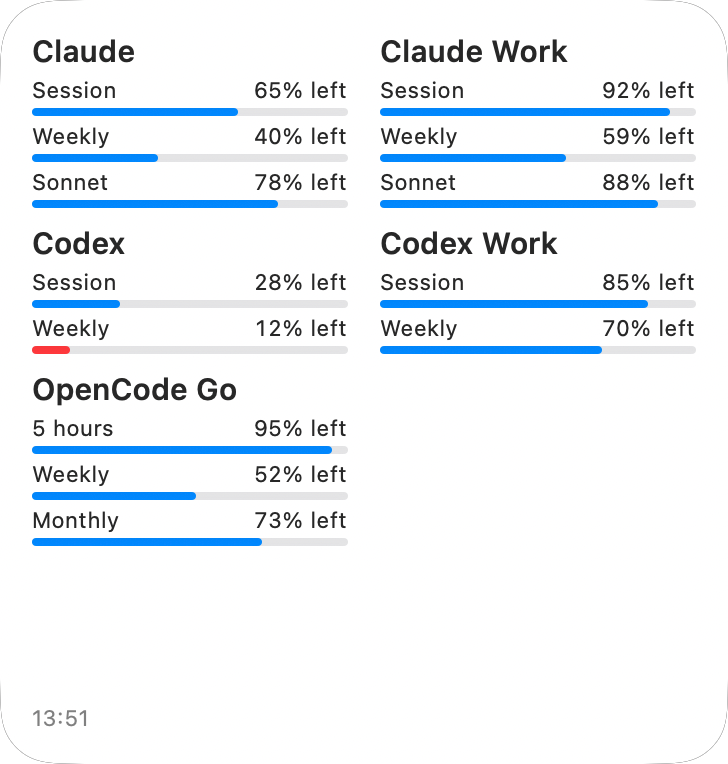

# Kota for iOS

An iPhone app and home screen widget showing how much of your Claude, Codex and OpenCode Go usage limits is left.
The iOS companion to [Kota for macOS](https://github.com/iSach/kota-gui).

*Large widget, rendered with sample data.*

- Several accounts per provider, each renamable and reorderable
- Sign in to claude.ai or ChatGPT inside the app, or paste a session cookie, access token or API key
- Small, medium and large widgets (1, 2 or up to 6 accounts)
- Show percent left or percent used
- Credentials stay in the device Keychain; the app talks only to the providers

## Build

Open `Kota.xcodeproj` in Xcode 26 or later, set your team on both targets, and run on an iPhone (iOS 17+).

- `./Tests/check.sh` runs the parser checks.
- `./Scripts/make-ipa.sh` builds an unsigned `build/Kota.ipa` for SideStore or AltStore.
